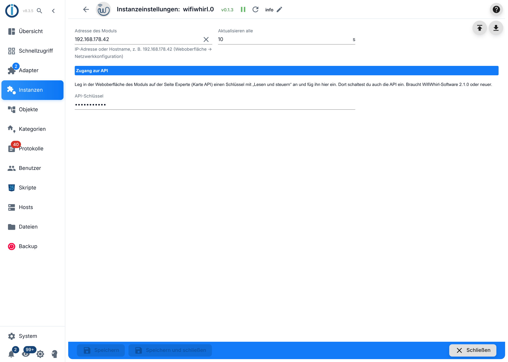
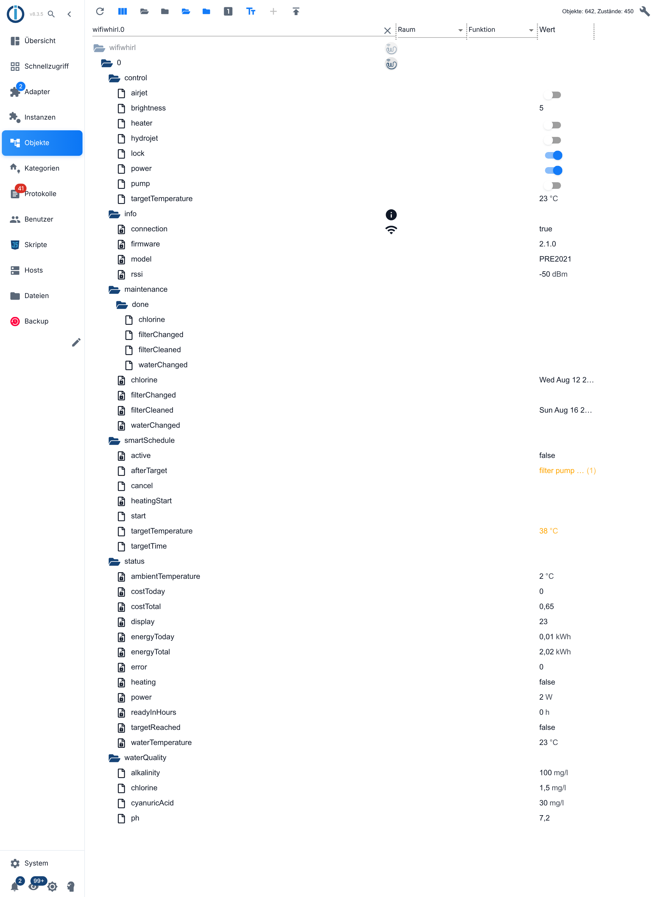

# WifiWhirl-Adapter - Benutzerhandbuch

Dies ist die deutsche Dokumentation - [🇺🇸 English version](../en/README.md)

Der Adapter verbindet ioBroker mit einem Bestway® Lay-Z-Spa™ Whirlpool, in dem das
[WifiWhirl](https://wifiwhirl.de)-Modul steckt. Er nutzt die lokale API des Moduls; ein MQTT-Broker oder
eine Cloud ist nicht nötig.

Eine ausführliche Anleitung mit Screenshots gibt es auch auf
[wifiwhirl.de/Integrationen/iobroker](https://wifiwhirl.de/Integrationen/iobroker).

## 1. Modul vorbereiten

1. Aktualisiere das Modul auf Software **2.1.0 oder neuer**.
2. Öffne die Weboberfläche des Moduls und geh auf die Seite **Experte**.
3. Schalte auf der Karte **API** die API ein.
4. Leg einen API-Schlüssel mit dem Recht **Lesen und steuern** an und kopiere ihn.

## 2. Adapter installieren und einrichten

1. Öffne im ioBroker-Admin **Adapter**, such nach **WifiWhirl** und installiere ihn.
2. Leg eine Instanz an. Der Einstellungsdialog öffnet sich:



| Einstellung | Beschreibung |
| --- | --- |
| Adresse des Moduls | IP-Adresse oder Hostname, z. B. `192.168.178.42`. Du findest sie in der Weboberfläche des Moduls unter *Netzwerkkonfiguration* oder in deinem Router. Gib dem Modul im Router eine feste IP-Adresse. |
| Aktualisieren alle | Wie oft die Werte gelesen werden, in Sekunden (5-3600, Standard 10). |
| API-Schlüssel | Der Schlüssel aus Schritt 1. Er wird verschlüsselt gespeichert. |

3. Speichern. Nach ein paar Sekunden steht `wifiwhirl.0.info.connection` auf `true`.

Eine Instanz steuert ein Modul. Für einen zweiten Whirlpool legst du eine zweite Instanz an.

## 3. Datenpunkte

Alle Datenpunkte liegen unter `wifiwhirl.<Instanz>`.



### control - schalten und einstellen (beschreibbar)

| Datenpunkt | Typ | Bedeutung |
| --- | --- | --- |
| `control.pump` | boolean | Filterpumpe ein/aus |
| `control.heater` | boolean | Heizung ein/aus. Schaltet beim Einschalten auch die Filterpumpe ein |
| `control.airjet` | boolean | AirJet (Sprudel) ein/aus |
| `control.hydrojet` | boolean | HydroJet ein/aus (nur Pumpen mit HydroJet) |
| `control.power` | boolean | Ganzer Whirlpool ein/aus |
| `control.lock` | boolean | Tastensperre an der Pumpe |
| `control.targetTemperature` | number, °C | Zieltemperatur, 20-40 |
| `control.brightness` | number | Displayhelligkeit, 0-8 |

Schalter nehmen `true`/`false` und `1`/`0` an. Ungültige Werte werden ignoriert und als Warnung geloggt.

### status - aktuelle Werte (nur lesen)

| Datenpunkt | Typ | Bedeutung |
| --- | --- | --- |
| `status.waterTemperature` | number, °C | Wassertemperatur |
| `status.ambientTemperature` | number, °C | Außentemperatur |
| `status.heating` | boolean | Die Heizung heizt gerade |
| `status.targetReached` | boolean | Zieltemperatur erreicht |
| `status.readyInHours` | number, h | Geschätzte Zeit, bis die Zieltemperatur erreicht ist |
| `status.error` | number | Fehlercode der Pumpe, 0 = kein Fehler |
| `status.display` | string | Was das Display der Pumpe anzeigt |
| `status.power` | number, W | Aktuelle Leistung |
| `status.energyToday` / `status.energyTotal` | number, kWh | Energie heute / seit Beginn der Zählung |
| `status.costToday` / `status.costTotal` | number | Kosten heute / gesamt, wie vom Modul berechnet |

### maintenance - wann zuletzt erledigt

| Datenpunkt | Typ | Bedeutung |
| --- | --- | --- |
| `maintenance.chlorine` | Datum | Letzte Chlorzugabe |
| `maintenance.filterCleaned` | Datum | Filter zuletzt gereinigt |
| `maintenance.filterChanged` | Datum | Filter zuletzt gewechselt |
| `maintenance.waterChanged` | Datum | Wasser zuletzt gewechselt |
| `maintenance.done.chlorine` … `maintenance.done.waterChanged` | Button | Drücken = Aufgabe jetzt erledigt |

Ein leeres Datum heißt "noch nie erledigt".

### waterQuality - Wasserwerte (beschreibbar)

| Datenpunkt | Einheit | Bedeutung |
| --- | --- | --- |
| `waterQuality.ph` | - | pH-Wert, 0-14 |
| `waterQuality.chlorine` | mg/l | Freies Chlor |
| `waterQuality.cyanuricAcid` | mg/l | Cyanursäure |
| `waterQuality.alkalinity` | mg/l | Gesamtalkalität |

Die Datenpunkte zeigen die letzte im Modul gespeicherte Messung. Schreibst du einen Wert, wird er als
neue Messung gespeichert.

### smartSchedule - bis zu einer Uhrzeit aufheizen

Das Modul berechnet selbst, wann es mit dem Heizen anfangen muss, damit das Wasser zur Zielzeit die
Zieltemperatur hat.

| Datenpunkt | Beschreibbar | Bedeutung |
| --- | :---: | --- |
| `smartSchedule.targetTime` | ✓ | Zielzeit als `JJJJ-MM-TT HH:MM`, z. B. `2026-12-24 19:00`, Zeitzone des ioBroker-Rechners |
| `smartSchedule.targetTemperature` | ✓ | Zieltemperatur, 20-40 °C (Standard 38) |
| `smartSchedule.afterTarget` | ✓ | Nach der Zielzeit: 0 = alles aus, 1 = nur Filterpumpe, 2 = Heizung hält die Temperatur |
| `smartSchedule.start` | ✓ | Button: schickt den Zeitplan an das Modul |
| `smartSchedule.cancel` | ✓ | Button: bricht den laufenden Zeitplan ab |
| `smartSchedule.active` | - | Ein Zeitplan läuft |
| `smartSchedule.heatingStart` | - | Wann das Modul mit dem Heizen beginnt |

Die drei Eingaben allein bewirken nichts. Der Zeitplan wird erst gesendet, wenn du
`smartSchedule.start` drückst. Ist eine Eingabe ungültig (falsches Format, Zeit in der Vergangenheit,
Temperatur außerhalb 20-40 °C), steht im Log "Smart Schedule not started" mit dem Grund.

### info

| Datenpunkt | Bedeutung |
| --- | --- |
| `info.connection` | Adapter ist mit dem Modul verbunden |
| `info.firmware` | Softwareversion des Moduls |
| `info.model` | Pumpenmodell |
| `info.rssi` | WLAN-Signal des Moduls in dBm (besser als -70 ist gut) |

## 4. Beispiele

### JavaScript

Für den Abend aufheizen und Bescheid geben, wenn das Wasser warm ist:

```js
setState('wifiwhirl.0.smartSchedule.targetTime', '2026-12-24 19:00');
setState('wifiwhirl.0.smartSchedule.targetTemperature', 38);
setState('wifiwhirl.0.smartSchedule.afterTarget', 2);
setState('wifiwhirl.0.smartSchedule.start', true);

on({ id: 'wifiwhirl.0.status.targetReached', val: true, change: 'ne' }, () => {
    log('Der Whirlpool ist bereit');
});
```

Chlorzugabe eintragen:

```js
setState('wifiwhirl.0.maintenance.done.chlorine', true);
```

### Blockly

Nimm den Block **steuere** (Aktionen) mit den Datenpunkten oben, z. B. *steuere wifiwhirl.0.control.heater mit true*.
Bei Buttons einmal `true` schreiben.

### VIS-2

Eine fertige deutsche Ansicht liegt im Repository:
[vis-2/whirlpool-view.de.json](../../vis-2/whirlpool-view.de.json). Leg im VIS-2-Editor eine Ansicht an,
wähle *Ansicht importieren* und füg den Inhalt der Datei ein. Sie nutzt die Instanz `wifiwhirl.0`.

## 5. Fehlersuche

Der Adapter meldet ein Problem einmal und wiederholt es erst, wenn sich die Meldung ändert. Die
Log-Meldungen sind englisch:

| Log-Meldung | Ursache und Lösung |
| --- | --- |
| Please enter the IP address or host name … | Keine oder ungültige Adresse in den Einstellungen. Trag nur die Adresse ein, z. B. `192.168.178.42`. |
| Please enter an API key … | Kein API-Schlüssel in den Einstellungen. |
| API key wrong or deleted | Den Schlüssel gibt es im Modul nicht (mehr). Leg einen neuen an und trag ihn ein. |
| … the key needs "read and control" | Der Schlüssel darf nur lesen. Leg einen mit "Lesen und steuern" an. |
| no API found: the module needs software 2.1.0 or newer | Modul aktualisieren oder Adresse prüfen. |
| too many wrong API keys, the module waits 30 seconds | Das Modul sperrt nach mehreren falschen Schlüsseln. Schlüssel korrigieren und warten. |
| no answer within 8 seconds | Modul nicht erreichbar: Adresse, WLAN-Signal (`info.rssi`) und Stromversorgung prüfen. |
| Command … failed | Das Modul hat einen Befehl abgelehnt oder nicht beantwortet; der Wert in ioBroker bleibt unverändert. |

**Werte ändern sich nach einem Befehl nicht:** Der Adapter liest die Werte 1,5 s nach einem Befehl neu.
Nimmt die Pumpe den Befehl nicht an, kommt der alte Wert zurück.

**Die Weboberfläche des Moduls ist langsam:** Das Modul bedient immer nur eine Verbindung gleichzeitig.
Erhöhe das Intervall in den Adapter-Einstellungen, wenn du die Weboberfläche viel nutzt.
