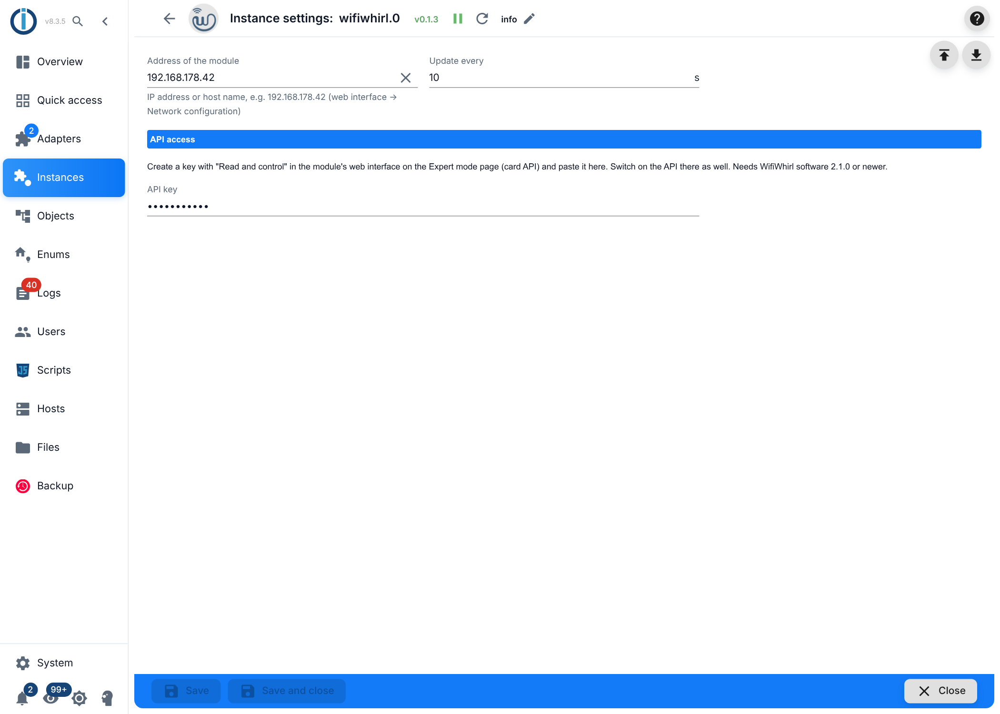
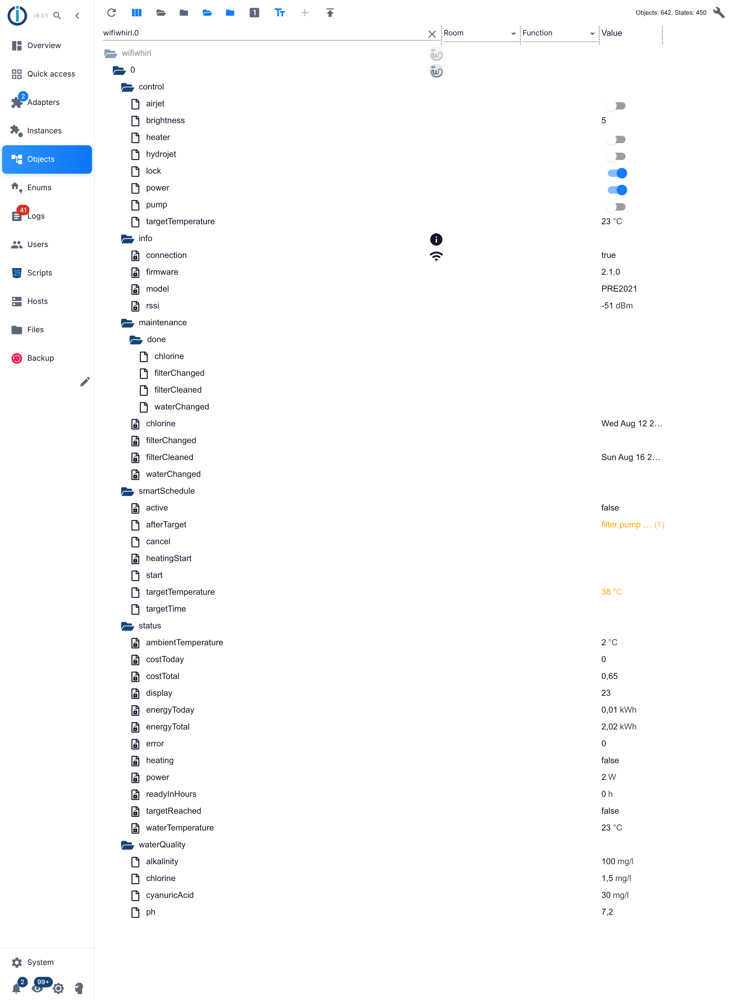

# WifiWhirl adapter - user guide

This is the English documentation - [🇩🇪 Deutsche Version](../de/README.md)

The adapter connects ioBroker to a Bestway® Lay-Z-Spa™ whirlpool with the [WifiWhirl](https://wifiwhirl.de)
module. It uses the module's local API; no MQTT broker and no cloud are involved.

## 1. Prepare the module

1. Update the module to software **2.1.0 or newer**.
2. Open the module's web interface and go to the page **Expert mode**.
3. On the card **API**, switch the API on.
4. Create an API key with the right **read and control** and copy it.

## 2. Install and configure the adapter

1. In ioBroker Admin, open **Adapters**, search for **WifiWhirl** and install it.
2. Create an instance. The settings dialog opens:



| Setting | Description |
| --- | --- |
| Address of the module | IP address or host name, e.g. `192.168.178.42`. You find it in the module's web interface under *Network configuration* or in your router. Give the module a fixed IP address in the router. |
| Update every | How often the values are read, in seconds (5-3600, default 10). |
| API key | The key from step 1. It is stored encrypted. |

3. Save. After a few seconds `wifiwhirl.0.info.connection` turns `true`.

One instance controls one module. For a second whirlpool, create a second instance.

## 3. States

All states are below `wifiwhirl.<instance>`.



### control - switch and set (writable)

| State | Type | Meaning |
| --- | --- | --- |
| `control.pump` | boolean | Filter pump on/off |
| `control.heater` | boolean | Heater on/off. Switching it on also switches the filter pump on |
| `control.airjet` | boolean | AirJet (bubbles) on/off |
| `control.hydrojet` | boolean | HydroJet on/off (only pumps with HydroJet) |
| `control.power` | boolean | Whole whirlpool on/off |
| `control.lock` | boolean | Button lock on the pump |
| `control.targetTemperature` | number, °C | Target temperature, 20-40 |
| `control.brightness` | number | Display brightness, 0-8 |

Switches accept `true`/`false` and `1`/`0`. Invalid values are ignored and logged as a warning.

### status - current values (read only)

| State | Type | Meaning |
| --- | --- | --- |
| `status.waterTemperature` | number, °C | Water temperature |
| `status.ambientTemperature` | number, °C | Outside temperature |
| `status.heating` | boolean | The heater is heating right now |
| `status.targetReached` | boolean | Target temperature reached |
| `status.readyInHours` | number, h | Estimated time until the target temperature is reached |
| `status.error` | number | Error code of the pump, 0 = no error |
| `status.display` | string | What the pump display shows |
| `status.power` | number, W | Current power |
| `status.energyToday` / `status.energyTotal` | number, kWh | Energy today / since the start of counting |
| `status.costToday` / `status.costTotal` | number | Costs today / total, as calculated by the module |

### maintenance - when was it done

| State | Type | Meaning |
| --- | --- | --- |
| `maintenance.chlorine` | date | Last chlorine added |
| `maintenance.filterCleaned` | date | Filter last cleaned |
| `maintenance.filterChanged` | date | Filter last changed |
| `maintenance.waterChanged` | date | Water last changed |
| `maintenance.done.chlorine` … `maintenance.done.waterChanged` | button | Press to mark the task as done now |

An empty date means "never done".

### waterQuality - water measurements (writable)

| State | Unit | Meaning |
| --- | --- | --- |
| `waterQuality.ph` | - | pH value, 0-14 |
| `waterQuality.chlorine` | mg/l | Free chlorine |
| `waterQuality.cyanuricAcid` | mg/l | Cyanuric acid |
| `waterQuality.alkalinity` | mg/l | Total alkalinity |

The states show the last measurement stored on the module. Writing a value saves a new measurement.

### smartSchedule - heat up by a set time

The module calculates when it has to start heating so the water has the target temperature at the
target time.

| State | Writable | Meaning |
| --- | :---: | --- |
| `smartSchedule.targetTime` | ✓ | Target time as `YYYY-MM-DD HH:MM`, e.g. `2026-12-24 19:00`, time zone of the ioBroker host |
| `smartSchedule.targetTemperature` | ✓ | Target temperature, 20-40 °C (default 38) |
| `smartSchedule.afterTarget` | ✓ | After the target time: 0 = everything off, 1 = filter pump only, 2 = heater keeps the temperature |
| `smartSchedule.start` | ✓ | Button: sends the schedule to the module |
| `smartSchedule.cancel` | ✓ | Button: cancels the running schedule |
| `smartSchedule.active` | - | A schedule is running |
| `smartSchedule.heatingStart` | - | When the module will start heating |

Setting the three inputs does nothing on its own. The schedule is only sent when `smartSchedule.start`
is pressed. If an input is invalid (wrong format, time in the past, temperature outside 20-40 °C), the
log shows "Smart Schedule not started" with the reason.

### info

| State | Meaning |
| --- | --- |
| `info.connection` | Adapter is connected to the module |
| `info.firmware` | Software version of the module |
| `info.model` | Pump model |
| `info.rssi` | WiFi signal of the module in dBm (above -70 is good) |

## 4. Examples

### JavaScript

Warm up for the evening and send a message when the water is ready:

```js
setState('wifiwhirl.0.smartSchedule.targetTime', '2026-12-24 19:00');
setState('wifiwhirl.0.smartSchedule.targetTemperature', 38);
setState('wifiwhirl.0.smartSchedule.afterTarget', 2);
setState('wifiwhirl.0.smartSchedule.start', true);

on({ id: 'wifiwhirl.0.status.targetReached', val: true, change: 'ne' }, () => {
    log('The whirlpool is ready');
});
```

Mark chlorine as added:

```js
setState('wifiwhirl.0.maintenance.done.chlorine', true);
```

### Blockly

Use the block **control** (Actions) with the states above, e.g. *control wifiwhirl.0.control.heater with true*.
For buttons, write `true` once.

### VIS-2

A ready-made view is in the repository: [vis-2/whirlpool-view.json](../../vis-2/whirlpool-view.json).
In the VIS-2 editor, create a view, choose *Import view* and paste the file content. It uses instance
`wifiwhirl.0`.

## 5. Troubleshooting

The adapter logs a problem once and repeats it only when the message changes.

| Log message | Cause and solution |
| --- | --- |
| Please enter the IP address or host name … | No or invalid address in the settings. Enter only the address, e.g. `192.168.178.42`. |
| Please enter an API key … | No API key in the settings. |
| API key wrong or deleted | The key does not exist on the module (any more). Create a new one and enter it. |
| … the key needs "read and control" | The key only has "read". Create a key with "read and control". |
| no API found: the module needs software 2.1.0 or newer | Update the module or check the address. |
| too many wrong API keys, the module waits 30 seconds | The module blocks after several wrong keys. Fix the key and wait. |
| no answer within 8 seconds | Module not reachable: check the address, WiFi signal (`info.rssi`) and whether the module is powered. |
| Command … failed | The module rejected or did not answer a command; the value in ioBroker stays unchanged. |

**Values do not change after a command:** the adapter reads the values again 1.5 s after a command.
If the pump does not accept the command, the old value comes back.

**The module's web interface is slow:** the module serves one connection at a time. Increase the
interval in the adapter settings if you use the web interface a lot.
